# Cortex (AAD-H1) — Enterprise Autonomous RAG & Operational Intelligence


Cortex is an enterprise-grade Autonomous Retrieval-Augmented Generation (RAG) and operational intelligence assistant. Built with **FastAPI**, **React 18 / Vite**, **PostgreSQL**, **Qdrant**, **Redis**, and **Celery**, Cortex provides secure multi-turn enterprise conversations, dynamic DAG-based query planning, multi-vector hybrid knowledge retrieval, human-in-the-loop action workflows, and a fully decoupled **Intelligent Memory Management System**.

---

## Table of Contents

- [System Architecture](#system-architecture)
- [Core Invariants & Enterprise Security](#core-invariants--enterprise-security)
  - [1. 3D RBAC Security Matrix](#1-3d-rbac-security-matrix)
  - [2. Zero-Write Connector Invariant](#2-zero-write-connector-invariant)
  - [3. Explicit Connector Routing Policy](#3-explicit-connector-routing-policy)
  - [4. Ledger Immutability & Lazy Compaction](#4-ledger-immutability--lazy-compaction)
  - [5. Prompt Injection & Context Sandboxing](#5-prompt-injection--context-sandboxing)
- [Intelligent Memory Management System](#intelligent-memory-management-system)
  - [Architecture & Tiering](#architecture--tiering)
  - [Zero-LLM Cost Retrieval Strategy](#zero-llm-cost-retrieval-strategy)
  - [Explicit Deterministic Commands](#explicit-deterministic-commands)
  - [Privacy & Secret Guardrails](#privacy--secret-guardrails)
  - [Canonical PostgreSQL Ledger & Sync Sweeper](#canonical-postgresql-ledger--sync-sweeper)
- [Performance & Resource Optimizations](#performance--resource-optimizations)
  - [Celery Memory Footprint (77 MiB Idle)](#celery-memory-footprint-77-mib-idle)
  - [Qdrant Client Pooling](#qdrant-client-pooling)
  - [Asynchronous Non-Blocking Titling](#asynchronous-non-blocking-titling)
- [Unified Development & Local Setup](#unified-development--local-setup)
  - [Quick Start](#quick-start)
  - [Prerequisites](#prerequisites)
  - [First-Time Configuration](#first-time-configuration)
- [Frontend & Administration Workspace](#frontend--administration-workspace)
- [API Reference Summary](#api-reference-summary)
  - [Memory Endpoints (`/api/v1/chat/memories`)](#memory-endpoints-apiv1chatmemories)
  - [Real-Time SSE Event Types](#real-time-sse-event-types)
- [Testing & Quality Assurance](#testing--quality-assurance)
  - [Running the Test Suite](#running-the-test-suite)
  - [Offline vs. Live LLM Verification (`--run-llm`)](#offline-vs-live-llm-verification---run-llm)
- [Project Directory Layout](#project-directory-layout)

---

## System Architecture

Cortex is architected into four decoupled operational zones arranged in a clean rectangular flow:

```mermaid
flowchart LR
    %% ===== COLUMN 1: ENTRY & AUTH =====
    subgraph C1["1. Client & Auth Boundary"]
        direction TB
        UI["React SPA\nChatPage · MemoriesPage\nProfilePage · Admin"]
        API["FastAPI Routers\n/chat · /chat/memories\n/documents · /admin"]
        AUTH["JWT Auth & RBAC\ncurrent_user.id\nDept + Clearance"]
        UI --> API --> AUTH
    end

    %% ===== COLUMN 2: MEMORY MANAGEMENT SYSTEM =====
    subgraph C2["2. Independent Memory Manager"]
        direction TB
        DET["Deterministic Detector\ncommand_detector.py\n(~0.1ms pre-filter)"]
        CMD["Explicit Command Executor\nADD · UPDATE · SUPERSEDE\nDELETE · RETRIEVE"]
        GUARD["Privacy & Secret Guard\nBlocks API keys, JWTs,\npasswords, sensitive PII"]
        RET["Zero-LLM Hybrid Retrieval\n1. Redis Prefs (<3ms)\n2. Count Fast-Exit (<1ms)\n3. Local Qdrant (~25ms)\n4. Broad-Personal PG Fallback"]
        DET -->|Explicit cmd| CMD --> GUARD
        DET -->|Normal / Compound| RET
    end

    %% ===== COLUMN 3: MAIN CHAT & DAG PIPELINE =====
    subgraph C3["3. Main Cortex Pipeline"]
        direction TB
        CTX["Short-Term Context\n8k Sliding Window\nWatermarked Summary"]
        PLAN["Query Rewriter & DAG Planner\n(Tool routing only,\ndecoupled from memory)"]
        TOOLS["Parallel DAG Tools\nInternal RAG (CRAG)\nSQL · GitHub · Drive\nWeb · Jira · Admin"]
        SYN["Sandboxed Synthesis\nUntrusted-data rules for\n<retrieved_context> &\n<user_preferences_and_context>"]
        CTX --> PLAN --> TOOLS --> SYN
    end

    %% ===== COLUMN 4: STORAGE, CACHE & WORKERS =====
    subgraph C4["4. Storage & Async Workers"]
        direction TB
        PG[("PostgreSQL\nSource of Truth\nusers · messages\nuser_memories (v, status)")]
        QD[("Qdrant (Local ONNX)\ncortex_documents\ncortex_user_memories\n(384d FastEmbed)")]
        RD[("Redis\nSSE Replay Streams\nPrefs & Count Cache\nRate Limiter · Locks")]
        BG["Async Post-Turn & Celery\nSingle-Call Reconciler\nAuto-Titling (Non-Blocking)\nSweeper (77MB RAM)"]
        BG --> PG
        BG --> QD
        BG --> RD
    end

    %% ===== CROSS-COLUMN FLOWS =====
    AUTH --> DET
    GUARD -->|Pure memory cmd: bypass RAG| UI
    CMD -->|Compound remaining query| RET
    RET --> CTX
    SYN -->|SSE: step · memory_event · token · citations · done| UI
    SYN -.->|Async post-turn| BG
    GUARD --> PG
    GUARD --> QD
    GUARD --> RD
    RET --> RD
    RET --> QD
    RET --> PG
    TOOLS --> QD
    TOOLS --> PG
```



---

## Core Invariants & Enterprise Security

### 1. 3D RBAC Security Matrix
Access control evaluates three orthogonal dimensions on every retrieval request:
- **Role Hierarchy**: `Admin` > `Manager` > `Employee`
- **Department Partitioning**: `Engineering`, `HR`, `Finance`
- **Clearance Level**: `Public` < `Internal` < `Confidential`

A user can only retrieve documents if their role, department, and clearance satisfy all three constraints simultaneously. Administrative actions and document ingestion are restricted to users with the `Admin` role.

### 2. Zero-Write Connector Invariant
All external Model Context Protocol (MCP) integrations are strictly **read-only**:
- **GitHub MCP Client**: Scoped to read operations (`search/code`, `issues`, `pulls`, raw file content).
- **Google Drive MCP Client**: Scoped to read operations (`files`, export to text/csv, `alt=media` downloads).
- ⛔ **Prohibited HTTP Methods**: `POST`, `PUT`, `DELETE`, and `PATCH` are strictly forbidden across external connectors during conversational synthesis.

### 3. Explicit Connector Routing Policy
- **Default Knowledge Retrieval**: Always routes exclusively to internal 3D RBAC enterprise RAG (`cortex_documents`).
- **Connector Isolation**: External connectors (`GITHUB_SEARCH`, `DRIVE_SEARCH`) are **never speculatively fanned out**. They trigger if and only if the employee explicitly mentions Drive or GitHub in their prompt (e.g. *"check Google Drive for the roadmap"*, *"find repo issues on GitHub"*), protecting context tokens and preserving external rate limits.

### 4. Ledger Immutability & Lazy Compaction
- The PostgreSQL `messages` table is **100% append-only and immutable**.
- Context compaction occurs in-memory at inference time: when a conversation crosses 8,000 tokens, older turns ($1 \dots N-4$) are compressed into an executive summary, preserving the most recent 4 raw turns intact.
- Compaction uses lazy hysteresis and is cached on `Conversation.summary`.

### 5. Prompt Injection & Context Sandboxing
All external and dynamic content is isolated within strict XML tags:
- External retrieval results are wrapped in `<retrieved_context>` blocks.
- Long-term user memory is sandboxed within `<user_preferences_and_context>` blocks.
- Both blocks are explicitly classified as untrusted data in the synthesis prompt, preventing indirect prompt injection from hijacking agent instructions.

---

## Intelligent Memory Management System

Cortex features an enterprise-grade, privacy-first long-term memory engine decoupled from the main query planner.

### Architecture & Tiering

| Tier | Storage | Retention | Invalidation & Lifecycle |
|---|---|---|---|
| **Tier 1: Authoritative Profile** | PostgreSQL `users` table | Permanent | Synced from HR/SSO profile (`name`, `department`, `role`, `clearance_level`). Injected into every turn. |
| **Tier 2: Hot Long-Term Memory** | Redis Cache (`user:{id}:pref_memories`) | Millisecond access | Fast-cached preference memories (<3ms) and active memory count (<1ms). Invalidated on write/delete. |
| **Tier 3: Cold Episodic Memory** | Qdrant + PostgreSQL `user_memories` | Persistent | Hybrid dense vector search (`bge-small-en-v1.5`, 384d) verified against PostgreSQL active records. |

### Zero-LLM Cost Retrieval Strategy
Previous iterations incurred 300–800ms of latency per turn running an LLM classifier to decide whether to search memory. Cortex eliminates this completely:
1. **Redis Preference Cache (<3ms)**: Active `preference` category memories are pre-loaded directly from Redis without hitting vector storage.
2. **Count Fast-Exit (<1ms)**: If `user:{id}:active_count` is 0, vector retrieval exits immediately.
3. **Local ONNX Vector Search (~25ms)**: Embeddings are generated locally via `fastembed` and queried in Qdrant with payload filters (`user_id`, `status: active`).
4. **Broad-Personal Fallback**: Deterministic cues trigger PostgreSQL category queries (0 LLM calls) for indirect prompts (e.g. *"what are my current goals?"*).

### Explicit Deterministic Commands
Users can manage their memory directly inside the chat. The deterministic detector inspects inputs in ~0.1ms:
- **`ADD`**: *"Remember that I prefer PostgreSQL over MongoDB."*
- **`UPDATE` / `SUPERSEDE`**: *"Update my favorite language to TypeScript."* (Old memory is marked `superseded` with a lineage pointer).
- **`DELETE`**: *"Forget my preferences about Python."* (Soft-deleted in PostgreSQL, purged from Qdrant and Redis).
- **`RETRIEVE`**: *"What do you remember about my tech stack?"*

**Fast-Path Execution**: Pure memory commands bypass the RAG/DAG pipeline entirely, mutating memory and responding with a verified factual summary in under 150ms. Compound commands execute the memory operation first, emit an SSE `memory_event`, and pass the remaining query to the RAG pipeline.

### Privacy & Secret Guardrails
`privacy_guard.py` deterministically intercepts and rejects sensitive data before it reaches the database:
- **Credentials & Secrets**: API keys (`sk-...`, `ghp_...`), JWT tokens, database connection strings containing passwords, private keys, credit cards.
- **Sensitive Personal Information**: Health and medical diagnoses, financial account numbers, passwords, sensitive private information.
- **XML Tag Stripping**: Strips `<system>`, `<prompt>`, and boundary tags to prevent jailbreak injection.

### Canonical PostgreSQL Ledger & Sync Sweeper
- **Single Source of Truth**: Every memory is stored in PostgreSQL `user_memories` with an optimistic concurrency `version`, `status` (`active`, `superseded`, `deleted`), and `sync_status`.
- **Bidirectional Celery Sweeper**: A periodic Celery Beat task reconciles any out-of-sync states (`pending_upsert`, `pending_delete`), retrying vector synchronization and purging orphan Qdrant points.

---

## Performance & Resource Optimizations

### Celery Memory Footprint (77 MiB Idle)
By default, standard Celery workers can balloon to **500MB+** idle RAM on Windows/Linux due to eager module loading (`litellm`, heavy parsers, ML frameworks) at startup. Cortex addresses this via:
- **PEP 562 Lazy Loading**: Heavy submodules in `backend/services/` and `backend/services/memory/` are imported dynamically via `__getattr__` only when tasks execute.
- **Deferred Task Imports**: Task modules load only their immediate database dependencies.
- **Worker Concurrency**: Set to `--concurrency=1` with `-P solo` for local development, reducing base worker RAM to **~77.2 MiB**.

### Qdrant Client Pooling
Instead of establishing a new HTTP connection per query, `backend/db/qdrant.py` uses a thread-safe singleton connection pool, eliminating TCP connection churn and handshake overhead.

### Asynchronous Non-Blocking Titling
First-turn conversation auto-titling previously blocked first-token delivery by 400–900ms. In Cortex, turn-1 titling is scheduled as an unawaited background task on the FastAPI event loop, achieving instant Time-to-First-Token (TTFT).

---

## Unified Development & Local Setup

### Quick Start

Launch the entire stack (PostgreSQL, Qdrant, Redis, FastAPI, Celery Worker, Celery Beat, and Vite) with a single command:

```cmd
.\start.bat
```

Or run via Python directly:

```powershell
python run.py
```

`run.py` automatically performs the following bootstrapping steps:
1. Copies `.env.example` to `.env` if no environment configuration exists.
2. Synchronizes Python dependencies via `uv sync --frozen` (or system pip).
3. Synchronizes frontend dependencies with `npm install` on first launch.
4. Verifies Docker daemon status and starts `cortex-postgres`, `cortex-qdrant`, and `cortex-redis`.
5. Starts the FastAPI backend (`http://localhost:8000`), Celery worker, Celery Beat, and Vite frontend (`http://localhost:5173`).
6. Pressing **Ctrl+C** cleanly shuts down all application processes while keeping database volumes intact.

### Prerequisites

- **Docker Desktop** (with Docker Compose enabled).
- **Python 3.14** (recommended via [uv](https://github.com/astral-sh/uv)).
- **Node.js 18+** and **npm**.

### First-Time Configuration

1. **Environment Variables**:
   Open `.env` after first boot and supply your LLM API keys:
   ```ini
   # Primary Model Context Protocol & LLM Configuration
   FAST_LLM=gemini/gemini-2.5-flash
   QUALITY_LLM=gemini/gemini-2.5-pro
   GEMINI_API_KEY=your_gemini_api_key_here
   ```
2. **Security Keys**:
   Set a random 32+ character string for `JWT_SECRET_KEY` prior to any shared deployment.
3. **Seed Users**:
   To seed standard RBAC demonstration accounts (`admin`, `manager_eng`, `employee_eng`, etc.):
   ```powershell
   python scripts/seed_users.py
   ```
   Admin credentials are printed to the console upon initial generation.

---

## Frontend & Administration Workspace

The frontend is a modern React 18 single-page application built with Vite and Tailwind CSS.

### Available Routes

| Route | Description | Access Level |
|---|---|---|
| `/login`, `/register` | Authentication and user onboarding | Public |
| `/chat` | Conversational workspace with multi-turn streaming | Authenticated |
| `/chat/:conversationId` | Specific conversation thread with history replay | Authenticated |
| `/memories` | Intelligent Memory Management console | Authenticated |
| `/profile` | User profile, department, and clearance details | Authenticated |
| `/admin/overview` | Platform health, token usage, and system stats | Admin |
| `/admin/documents` | Ingested document catalog and reindexing engine | Admin |
| `/admin/users` | User management and 3D RBAC permission controls | Admin |
| `/admin/quality` | Evaluation benchmarks and LLM quality scoring | Admin |
| `/admin/audit` | Security audit trail and immutable system logs | Admin |

---

## API Reference Summary

### Memory Endpoints (`/api/v1/chat/memories`)

All endpoints enforce authenticated `current_user.id` tenancy:

- `GET /api/v1/chat/memories` — List user memories with filtering (`category`, `search`, `status`, pagination).
- `GET /api/v1/chat/memories/search` — Hybrid semantic vector + keyword search (`q`, `category`, `limit`).
- `POST /api/v1/chat/memories` — Create a memory with PrivacyGuard validation (`422` on sensitive secret/PII).
- `GET /api/v1/chat/memories/{memory_id}` — Get single memory details.
- `PATCH /api/v1/chat/memories/{memory_id}` — Update memory content/category with optimistic concurrency (`409` on version conflict).
- `DELETE /api/v1/chat/memories/{memory_id}` — Soft-delete memory and evict from Qdrant and Redis.
- `DELETE /api/v1/chat/memories` — Bulk delete by `category` or `delete_all=true`.
- `POST /api/v1/chat/memories/bulk-delete` — Scoped multi-ID deletion.

### Real-Time SSE Event Types

Chat responses stream via Server-Sent Events (`POST /api/v1/chat/conversations/{id}/messages`):

| Event Type | Payload Content | Purpose |
|---|---|---|
| `step` | `{"step": "Planning query execution..."}` | Real-time agent status indicator |
| `token` | `{"token": "text"}` | Streaming generation chunk |
| `citations` | `[{"document_id": "...", "title": "..."}]` | Grounded source citations |
| `action_card` | `{"action_id": "...", "status": "DRAFT"}` | JSM Human-in-the-Loop action draft |
| `memory_event`| `{"action": "ADDED", "content": "..."}` | Real-time memory mutation notification |
| `suggestions` | `["Follow-up question 1", "..."]` | Dynamic contextual suggestions |
| `done` | `{"message_id": "..."}` | Stream completion marker |

---

## Testing & Quality Assurance

### Running the Test Suite

Run the complete test suite using the bundled test runner:

```cmd
.\test.bat
```

Or via `pytest` directly:

```powershell
uv run pytest tests/unit tests/integration
```

Run specific test modules or filters:

```powershell
uv run pytest tests/unit/test_memory_manager.py
uv run pytest tests/integration/test_e2e_flows.py -v
uv run pytest -k "rbac"
```

### Offline vs. Live LLM Verification (`--run-llm`)

By default, the entire test suite executes **100% offline** using deterministic fixtures and mocked LLM providers, ensuring rapid, reliable CI/CD runs without consuming API quotas:

- **Offline Mode (Default)**: 170/170 tests passing. All query planner, memory extraction, and tool execution tests run deterministically.
- **Live LLM Mode (`--run-llm`)**:
  ```powershell
  uv run pytest tests/integration/test_e2e_flows.py --run-llm
  ```
  Passes live prompts to configured LLM providers in `.env` to verify real-world synthesis quality.

---

## Project Directory Layout

```
cortex/
├── backend/
│   ├── db/                 # Database initialization, PostgreSQL sessions, Qdrant client pool
│   ├── models/             # SQLModel schemas (User, Conversation, Message, UserMemory, Document)
│   ├── routers/            # FastAPI route handlers (auth, chat, memories, documents, admin)
│   ├── services/
│   │   ├── memory/         # Decoupled Memory Manager (command detector, privacy guard, store)
│   │   ├── orchestration/  # Chat orchestration, query planner, DAG executor, JSM action drafts
│   │   └── rag/            # FastEmbed dense embeddings, BM25 sparse index, Reciprocal Rank Fusion
│   ├── worker/             # Celery application, tasks, and reconciliation sweeper
│   └── main.py             # FastAPI application entry point and lifespan handlers
├── frontend/
│   ├── src/
│   │   ├── chat/           # ChatPage, message stream renderer, SSE handler, memory cards
│   │   ├── components/     # UI primitives, memory modals, navigation sidebar, toolbars
│   │   ├── pages/          # MemoriesPage, ProfilePage, Admin pages (Documents, Users, Audit)
│   │   └── services/       # API clients and TypeScript interfaces
│   └── package.json        # Vite, React 18, and frontend tooling
├── docs/                   # System design, PRDs, memory specs, and architectural diagrams
├── scripts/                # Database seeding, integration pings, and administrative utilities
├── storage/                # Persistent document originals and Celery Beat schedules
├── tests/
│   ├── unit/               # 150+ unit tests (memory manager, planner, RBAC, connectors)
│   └── integration/        # End-to-end multi-turn flows, JSM workflows, and replay buffers
├── run.py                  # Unified stack orchestrator
├── start.bat               # Windows quick-launch runner
└── test.bat                # Automated test runner
```

---

## License

Enterprise proprietary. All rights reserved.
